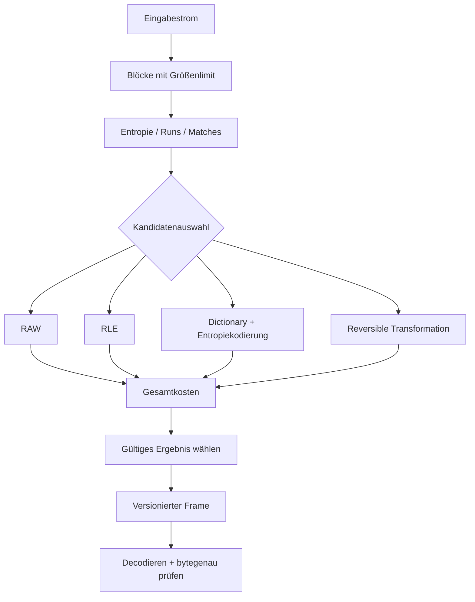

<div align="center">

# HobbitZip
### Eine Untersuchung adaptiver, verlustfreier Datenkompression


**Informationstheorie** · **Verlustfreie Kodierung** · **Adaptive Blockauswahl** · **Systemleistung**

[English](./README.md) · [**Deutsch**](./README.de.md) · [Türkçe](./README.tr.md)

</div>

---

## Zusammenfassung

**HobbitZip** untersucht eine zentrale Frage der Systemtechnik: **Kann ein verlustfreier Kompressor durch datenabhängige Auswahl geeigneter Kodierungsverfahren kleinere Ausgaben erzielen, ohne die Dekompression unverhältnismäßig teuer zu machen?**

Kompression ist nicht nur die Wahl eines Algorithmus. Sie ist ein Optimierungsproblem zwischen Informationsgehalt, Modellkomplexität, Format-Overhead, CPU-Zeit, Speicherbedarf, Eingabegröße und Decodierkosten.

Untersucht werden **reversible Transformationen**, **Dictionary- und Lauflängenkodierung**, **Entropiekodierung**, **blockweise Verfahrenswahl** und **reproduzierbare Messungen gegen etablierte Codecs**. Die dargestellte Architektur beschreibt ein Forschungsmodell. Es werden keine experimentell unbelegten Kompressionsraten oder Geschwindigkeitsvorteile behauptet.


## 1. Mathematische Problemstellung

Für eine Bytefolge \(x\in\{0,\ldots,255\}^n\) müssen verlustfreier Encoder \(E\) und Decoder \(D\) erfüllen:

$$
\boxed{D(E(x))=x\quad\forall\,x}
$$

Diese Gleichheit gilt **bytegenau**. Eine nur visuell ähnliche Datei ist kein verlustfrei wiederhergestelltes Original.

Für die ursprüngliche Größe \(n\) und die kodierte Gesamtgröße \(m\) in Bytes gelten:

$$
R(x)=\frac{n}{m},\qquad
S(x)=1-\frac{m}{n},\qquad n>0,\ m>0.
$$

\(R\) bezeichnet das Kompressionsverhältnis, \(S\) die relative Platzersparnis. **Header, Blockdeskriptoren, Wörterbücher, Prüfsummen und Metadaten zählen zu \(m\)**. Leere Eingaben benötigen eine gesonderte Behandlung.

### Warum es keinen universellen Sieger geben kann

Für \(n\) Eingabebits existieren \(2^n\) mögliche Folgen. Kürzere Bitfolgen gibt es dagegen nur

$$
\sum_{k=0}^{n-1}2^k=2^n-1.
$$

Daraus folgt: Keine injektive, eindeutig decodierbare Abbildung kann **jede** Eingabe verkleinern. Manche Daten müssen unverändert bleiben oder wachsen. Ein RAW-Fallback ist deshalb eine notwendige Strategie.

## 2. Informationstheoretisches Modell

Für eine diskrete Symbolquelle mit Wahrscheinlichkeiten \(p_i\) lautet die Shannon-Entropie:

$$
H(X)=-\sum_i p_i\log_2 p_i
\quad\text{Bit/Symbol}.
$$

Bei einer idealisierten gedächtnislosen Quelle nähert sich die optimale Gesamtkodierung für \(n\) Symbole \(nH(X)\) Bit, unter Berücksichtigung der Modellannahmen. Bei korrelierten Daten ist dagegen die **bedingte Entropie beziehungsweise Entropierate** relevant; ein Bytehistogramm beschreibt deren Komprimierbarkeit nicht vollständig.

Die empirische Entropie nullter Ordnung eines Blocks \(b\) kann geschätzt werden durch

$$
\widehat H_0(b)=
-\sum_{a\in\Sigma}\frac{f_a}{|b|}
\log_2\left(\frac{f_a}{|b|}\right),
$$

wobei \(f_a\) die Symbolhäufigkeit bezeichnet und Nullterme entfallen. Diese Schätzung unterstützt die Kandidatenauswahl, ist aber **keine Garantie** für die endgültige Dateigröße.


Zwei Blöcke können identische Häufigkeitsverteilungen und trotzdem stark unterschiedliche Wiederholungsstrukturen besitzen. Dictionary-Verfahren nutzen Sequenzen, die ein Modell nullter Ordnung nicht erfassen kann.

## 3. Kandidaten für Kodierung und Transformation

| Verfahren | Prinzip | Eignung | Kosten |
|---|---|---|---|
| **RAW** | Originalbytes ohne Verdichtung | Fallback bei hoher Entropie | Header |
| **RLE** | Wiederholte Symbole als Läufe | Lange identische Sequenzen | Expansion unregelmäßiger Daten |
| **LZ77** | Rückverweise auf frühere Teilfolgen | Wiederkehrende Muster | Suche und Dictionary-Speicher |
| **Huffman** | Häufigen Symbolen kürzere Präfixcodes zuordnen | Ungleich verteilte Häufigkeiten | Codelängen, Tabellen |
| **rANS / FSE** | Zustandsbasierte Entropiekodierung | Gute Rate bei geeignetem Modell | Normalisierung, Tabellen, Komplexität |
| **Transformation + Kodierung** | Reversible Vorverarbeitung | Strukturierte Daten | Zusätzlicher Rechenaufwand |

Dies sind **untersuchte Kandidaten**, nicht die Behauptung, dass alle bereits implementiert sind oder dass bekannte Kodierverfahren hier neu erfunden wurden.

### 3.1 Lauflängenkodierung

Ein Lauf lässt sich als \((v,\ell)\) ausdrücken: Wert \(v\), Wiederholungszahl \(\ell\). Der Lauf spart nur dann Bytes, wenn seine kodierte Darstellung einschließlich Tag kleiner ist als der Originalinhalt:

$$
C_{\mathrm{RLE}}(\ell)=B(v)+B(\ell)+B_{\mathrm{tag}}
\quad<8\ell.
$$

Ein echtes Format benötigt außerdem eine eindeutige Unterscheidung zwischen Literal- und Laufsegmenten.

### 3.2 LZ77 und Rückverweise

Ein Match-Token ist abstrakt

$$
t=(d,\ell),\qquad 1\le d\le W,
$$

mit Rückwärtsdistanz \(d\), Matchlänge \(\ell\) und begrenztem Fenster \(W\). Nicht übereinstimmende Zeichen bleiben Literale. Größere Fenster finden weiter entfernte Wiederholungen, erhöhen aber Such- und Speicheraufwand.

Greedy oder Lazy Parsing, Hash-Tabellen und Kettenlimits beeinflussen die Kodierung. Der Decoder muss überlappende Matches korrekt kopieren sowie ungültige Distanzen und Längen ablehnen.

### 3.3 Huffman-Kodierung

Präfixcode-Längen \(\ell_i\) erfüllen die Kraft-Ungleichung:

$$
\sum_i2^{-\ell_i}\le1.
$$

Für einen optimalen binären Huffman-Code unter üblichen Annahmen gilt für die durchschnittliche Codelänge \(L\):

$$
H(X)\le L<H(X)+1.
$$

In realen Dateien erhöhen Codebuch, Alignment und Header den Platzbedarf. Bei kleinen Blöcken kann die Kodiertabelle den Vorteil zunichtemachen.

### 3.4 rANS als Zustandsmodell

Für das Symbol \(s\) mit Frequenz \(f_s\), kumulierter Frequenz \(C_s\) und Gesamthäufigkeit \(F=\sum_s f_s\) lautet eine abstrakte rANS-Abbildung:

$$
x'=\left\lfloor\frac{x}{f_s}\right\rfloor F
+C_s+(x\bmod f_s).
$$

Für die inverse Abbildung bestimmt \(q=x'\bmod F\) das Symbol über \(C_s\le q<C_s+f_s\); der vorherige Zustand ergibt sich als

$$
x=f_s\left\lfloor\frac{x'}{F}\right\rfloor+q-C_s.
$$

Die Formeln beschreiben den **unnormalisierten Kern**. Byteweise Renormalisierung, Zustandsgrenzen, Reihenfolge der Symbole und Tabellencodierung müssen für eine echte Implementierung zusätzlich festgelegt werden. ANS ist ein bestehendes Verfahren.

## 4. Adaptive Blockauswahl

Die Eingabe kann in Blöcke \(b_1,\ldots,b_k\) aufgeteilt werden. Jeder Block wird statistisch beschrieben; mehrere Kandidatenpfade werden nach tatsächlich kodierten Kosten verglichen.



Mit Kandidatenpfad \(p\) kann ein Optimierungsziel formuliert werden als

$$
p^*=\arg\min_{p\in\mathcal P_{\mathrm{valid}}}
\left[B_p(b)+\lambda T_p(b)+\mu M_p(b)\right].
$$

\(B_p\) umfasst Payload **und Metadatenbits**, \(T_p\) den Kodieraufwand, \(M_p\) die Speicherkosten. \(\lambda,\mu\) gewichten Anwendungspräferenzen in kompatiblen Einheiten. Dies ist eine **Forschungszielfunktion**, kein bereits kalibrierter Algorithmus.

Für reine Größenoptimierung gilt \(\lambda=\mu=0\); latenzkritische Anwendungen können schnellere Varianten bevorzugen.

### Minimum Description Length

Entscheidend ist nicht allein die Größe der kodierten Daten, sondern auch die Beschreibung des verwendeten Modells:

$$
L_{\mathrm{total}}=
L(\mathrm{Modell})+L(\mathrm{Daten}\mid\mathrm{Modell})+
L(\mathrm{Framing}).
$$

Sehr detaillierte Modelle können bei kleinen Eingaben schlechter abschneiden, weil ihr Overhead die Einsparung übersteigt.

## 5. Frame- und Streamformat

Ein möglicher selbstbeschreibender Frame könnte folgende Struktur besitzen:

```text
+-----------------------+
| Magic + Version       | Formatkennung und Kompatibilität
+-----------------------+
| Frame-Flags           | Parameter und Grenzen
+-----------------------+
| Originalgröße         | Maximale erwartete Ausgabe
+-----------------------+
| Blockdeskriptoren     | Methode / kodierte und originale Größe
+-----------------------+
| Block-Payloads        | RAW / RLE / Dictionary / Entropie
+-----------------------+
| Prüffeld              | Erkennung versehentlicher Beschädigung
+-----------------------+
```

Die Struktur ist **illustrativ und noch keine festgelegte Binärspezifikation**. Blockunabhängigkeit, übergreifende Wörterbücher und Random Access beeinflussen die Formatentscheidung. Prüfsummen dienen der Fehlererkennung, **nicht** der kryptografischen Authentifizierung.

## 6. Decoder-Sicherheit

Ein belastbarer Decoder muss mehr leisten als eine erfolgreiche Eigen-Round-Trip-Prüfung:

1. Magic, Version und erlaubte Flags prüfen.
2. Integer-Überläufe bei Längen, Offsets und Allokationen verhindern.
3. Maximale Block-, Fenster-, Ausgabe- und Speichergrößen erzwingen.
4. Rückverweise und Literalbereiche strikt validieren.
5. Exakte Ausgabelänge verlangen.
6. Beschädigte und abgeschnittene Ströme eindeutig zurückweisen.
7. Dekompressionsbomben und übermäßige Expansion begrenzen.
8. Property-Based Testing, Fuzzing, Testvektoren und unabhängige Decoder-Prüfungen einsetzen.

Zwei fehlerhafte, aufeinander abgestimmte Encoder und Decoder können denselben Defekt verbergen. Daher gehören Interoperabilität und gezielte Negativtests zur Korrektheitsbewertung.

## 7. Reproduzierbare Benchmarks

| Datenklasse | Untersuchungszweck |
|---|---|
| Texte und Quellcode | Symbolverteilung, Wörterbuch |
| JSON, CSV, Protokolle | Struktur- und Feldwiederholungen |
| Ausführbare Binärdateien | Gemischte Muster |
| Rohbilder und numerische Arrays | Struktur und Korrelation |
| JPEG, PNG, ZIP, MP4 | Bereits kodierte oder komprimierte Inhalte |
| Zufallsdaten | Fallback und Worst Case |
| Kleinste Dateien und große Streams | Overhead versus Durchsatz |
| Defekte / abgeschnittene Streams | Decoder-Sicherheit |

Für jede Testkonfiguration sollen **komprimierte Bytes, Kompressionsverhältnis, Kompressions-MB/s, Dekompressions-MB/s, Peak-RSS, CPU, Plattform und Integrität** erfasst werden.

Messungen erfordern identische Hardware, Korpus, Threadzahl und CPU-Einstellungen; Warm-ups, wiederholte Durchläufe, Median und Streuung gehören ebenso dazu wie Buildflags, Versionsnummern und Hashes der Testdaten. Single-Thread- und Multi-Thread-Durchsatz müssen getrennt ausgewiesen werden.

Als reproduzierbare Referenzen dienen unter anderem **zlib/DEFLATE, Zstandard, LZ4 und Brotli**. Sinnvolle Diagramme vergleichen **Größe gegen Kodierzeit**, **Decodierdurchsatz gegen RAM** und **Ratio je Datensatz**. Die SVG-Diagramme dieser Dokumentation zeigen Konzepte, **keine gemessenen Benchmarkwerte**.

## 8. Entscheidungsräume und Komplexität

| Entscheidung | Möglicher Vorteil | Kosten |
|---|---|---|
| Größeres Suchfenster | Entfernte Matches | RAM und Suchzeit |
| Genauere Match-Suche | Kürzere Tokenfolge | Höhere Kodierlatenz |
| Komplexeres Entropiemodell | Bessere Wahrscheinlichkeitsschätzung | Tabellen-Overhead |
| Kleinere Blöcke | Lokale Anpassung, unabhängiges Decoding | Mehr Header |
| Größere Blöcke | Bessere Header-Amortisierung | RAM, Latenz |
| Reversible Transformation | Redundanz sichtbar machen | Extra CPU und Inversion |
| RAW-Fallback | Expansion begrenzen | Keine Ersparnis |

## 9. Forschungsthese und Grenzen

Der untersuchte Ansatz ist die **datenabhängige Auswahl reversibler Kodierungspfade unter messbaren Größen-, Latenz- und Speichergrenzen**. Er behauptet keine neuen informationstheoretischen Schranken.

Jedes Experiment muss drei Fragen beantworten: Ist die Ausgabe korrekt und bytegenau? Ist der gesamte Stream inklusive Modellkosten kleiner? Ist ein eventueller Größengewinn den Zeit- und Speicheraufwand wert?

**Dieses Repository ist eine öffentliche Forschungs- und Architekturpräsentation. Formeln und Diagramme sind weder ein Nachweis vollständiger Implementierung noch ein behauptetes Benchmarkergebnis.**

## Literatur

- C. E. Shannon, *A Mathematical Theory of Communication* (1948).
- [RFC 1951 — DEFLATE](https://www.rfc-editor.org/rfc/rfc1951).
- [RFC 8878 — Zstandard](https://www.rfc-editor.org/rfc/rfc8878).
- [RFC 7932 — Brotli](https://www.rfc-editor.org/rfc/rfc7932).
- J. Duda, *Asymmetric Numeral Systems* (2013), [arXiv:1311.2540](https://arxiv.org/abs/1311.2540).

---

<div align="center">

**HobbitZip** · Informationstheorie × Algorithmen × Systemtechnik

Entwickelt von [Taha Kubilay](https://github.com/tahakubilay) · [English](./README.md) · [Türkçe](./README.tr.md)

</div>
