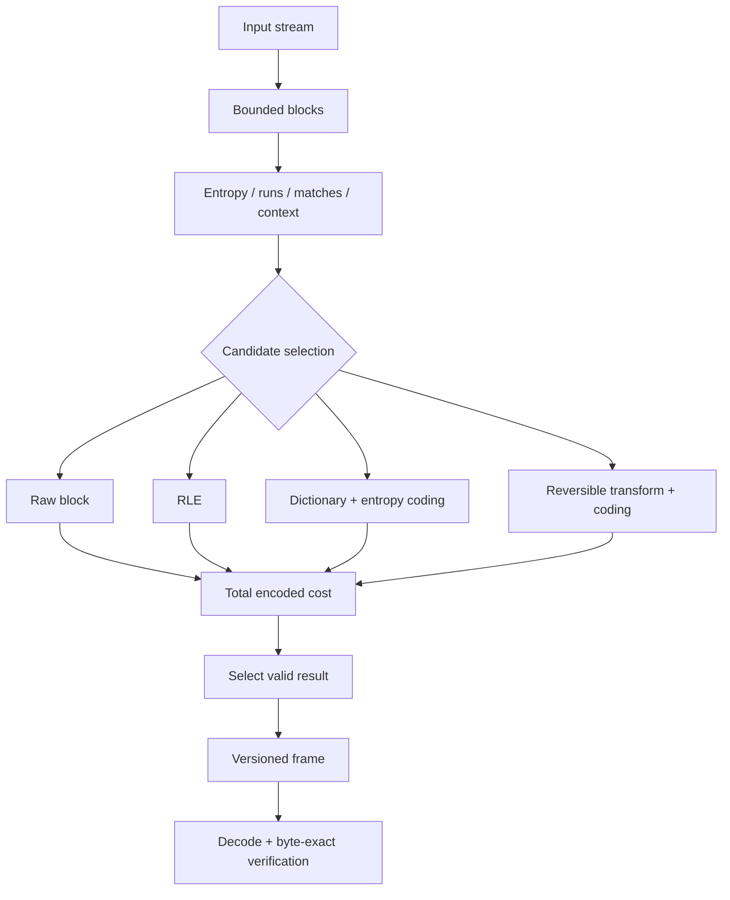

<div align="center">

# HobbitZip
### An investigation into adaptive, lossless data compression


**Information Theory** · **Lossless Coding** · **Adaptive Block Selection** · **Systems Performance**

[**English**](./README.md) · [Deutsch](./README.de.md) · [Türkçe](./README.tr.md)

</div>

---

## Abstract

**HobbitZip** examines a central systems question: **can a lossless compressor make better decisions by adapting its coding path to the statistical structure of each region of input data—without making decoding disproportionately expensive?**

Compression is not only a matter of selecting an algorithm. It is an optimization problem involving information content, model complexity, format overhead, CPU time, memory usage, input size and the cost of decompression.

The research focuses on **reversible transforms**, **dictionary and run-length coding**, **entropy coding**, **block-level method selection**, and **reproducible comparison with established codecs**. The architecture below is a research model; no benchmark, ratio or algorithmic advantage is presented as an experimentally established result.


## 1. Problem Formulation

Let an input byte string be \(x \in \{0,\ldots,255\}^{n}\). A lossless encoder \(E\) and decoder \(D\) must satisfy:

$$
\boxed{D(E(x)) = x \quad \forall\,x}
$$

The equality is exact at the **byte level**. Producing visually similar text or an approximately reconstructed image is not lossless compression.

For a compressed representation of length \(m\) bytes:

$$
R(x) = \frac{n}{m}, \qquad
S(x) = 1 - \frac{m}{n}, \qquad n>0,\ m>0
$$

Here \(R\) is the compression ratio and \(S\) is fractional space saving. **All headers, block descriptors, dictionaries, checksums and metadata must be counted in \(m\)**. Empty-input and zero-length results need explicit handling rather than division by zero.

A high compression ratio alone is insufficient: a method may be impractically slow, memory-hungry or expensive to decode.

### The impossibility of a universal winner

For fixed-length inputs of \(n\) bits, there are \(2^n\) possible values. There are only

$$
\sum_{k=0}^{n-1}2^k = 2^n - 1
$$

bit strings shorter than \(n\). Therefore, an injective, universally decodable mapping **cannot make every possible input shorter**. Some inputs must retain their size or expand. This is why a raw-block fallback is a necessary design option, not a failed compression attempt.

## 2. Information-Theoretic Model

For a discrete symbol source \(X\) with probabilities \(p_i\), Shannon entropy is

$$
H(X)=-\sum_i p_i\log_2 p_i \quad \text{bits/symbol}.
$$

For an idealized memoryless source of \(n\) symbols, the theoretical coding rate approaches \(nH(X)\) bits, subject to modeling assumptions and representation overhead. Correlated inputs must instead be considered in terms of **conditional entropy or entropy rate**; a simple byte-frequency histogram cannot fully describe their compressibility.

The observed zero-order entropy estimate for an input block \(b\) is

$$
\widehat H_0(b)=-\sum_{a\in\Sigma}\frac{f_a}{|b|}
          \log_2\left(\frac{f_a}{|b|}\right),
$$

where \(f_a\) is the count of symbol \(a\) and zero-frequency terms are omitted. This statistic is useful for selecting research candidates, but **not a guaranteed prediction** of final output size.


### Why transformations matter

Consider two blocks with similar byte frequencies. One may contain long repeated sequences, while the other interleaves the same symbols irregularly. The first may be easier for a dictionary compressor even though their zero-order histograms look similar. This motivates looking beyond \(H_0\) toward repeats, runs, context dependence and representation costs.

## 3. Candidate Coding Families

| Family | Mechanism | Strength | Important cost |
|---|---|---|---|
| **RAW** | Store bytes verbatim | Safe fallback for incompressible blocks | Header overhead |
| **RLE** | Encode repeated runs | Long runs of identical values | Expands irregular data |
| **LZ77-style** | Replace repeated substrings with backward references | Recurring sequences and structural repetition | Match search, window memory |
| **Huffman** | Assign shorter prefix codes to frequent symbols | Simple, fast decoding for skewed distributions | Integer-length codes and tree metadata |
| **rANS / FSE-style** | Encode symbols through a finite-state entropy model | Rates close to modeled entropy with suitable distributions | State normalization, model tables, implementation complexity |
| **Transform + entropy code** | Reversible preprocessing before symbol coding | Data with useful structure | Transform cost and inverse complexity |

These are **candidate research paths**, not a claim that HobbitZip already implements each one or introduces a new proven entropy coder.

### 3.1 Run-length coding

A run of repeated symbols can be represented conceptually as \((v,\ell)\): symbol \(v\) and length \(\ell\). Compression is beneficial only when the encoded run plus its framing overhead is smaller than storing the original run.

$$
C_{\mathrm{RLE}}(\ell)
  = B(v) + B(\ell) + B_{\mathrm{tag}}
$$

The break-even condition is \(C_{\mathrm{RLE}}(\ell) < 8\ell\) bits for a byte-valued run. A practical stream must also distinguish literal segments from run segments.

### 3.2 Dictionary matching / LZ77

A repeated sequence may be represented by a backward-reference token:

$$
t=(d,\ell),\qquad 1\le d\le W
$$

where \(d\) is the backward distance, \(\ell\) is the match length, and \(W\) is a bounded history window. Unmatched bytes are emitted as literals.

Larger windows can find distant matches but increase matching cost and memory. The encoder's parsing strategy—greedy versus lazy matching, chain limits, hash tables—can matter as much as token format.

A token stream must be safely decodable: every distance must refer to valid history, lengths must remain within configured bounds, and overlapping match copies must be handled correctly.

### 3.3 Huffman coding

With probabilities \(p_i\), a binary prefix code assigns lengths \(\ell_i\) satisfying the Kraft inequality:

$$
\sum_i 2^{-\ell_i} \le 1.
$$

For an optimal binary Huffman code over the modeled alphabet, average code length \(L\) obeys

$$
H(X) \le L < H(X)+1
$$

under the usual nondegenerate discrete-source assumptions. In a real block, codebook description and byte alignment also consume space. For small blocks, a sophisticated codebook may cost more than it saves.

### 3.4 ANS-style state coding

An abstract range-ANS (rANS) coding step for symbol \(s\), frequency \(f_s\), cumulative frequency \(C_s\), and total \(F=\sum_s f_s\) can be written:

$$
x'=\left\lfloor \frac{x}{f_s} \right\rfloor F
   + C_s + (x\bmod f_s).
$$

For decoding, \(q=x'\bmod F\) selects the symbol whose cumulative interval satisfies \(C_s\le q<C_s+f_s\), and the previous state is

$$
x=f_s\left\lfloor\frac{x'}{F}\right\rfloor +q-C_s.
$$

This describes the **core unnormalized state mapping**. A real implementation must additionally define byte-wise renormalization, state bounds, symbol order, table serialization and deterministic decoder behavior. ANS is a known coding family, not a novel HobbitZip invention.

## 4. Adaptive Block Selection

Rather than assuming one method suits an entire file, a candidate architecture partitions the input into blocks \(b_1,\ldots,b_k\) and evaluates several coding paths.



If \(p\) denotes a candidate path, a practical selection objective can be expressed as

$$
p^* = \arg\min_{p\in\mathcal P_{\mathrm{valid}}}
  \left[B_p(b)+\lambda T_p(b)+\mu M_p(b)\right].
$$

Here \(B_p\) includes compressed payload **and metadata bits**, \(T_p\) is measured encoding effort, \(M_p\) a memory-cost term, and \(\lambda,\mu\) express deployment preferences in compatible units. This is a **research objective**, not a benchmark-derived decision rule.

A size-only configuration sets \(\lambda=\mu=0\). A latency-sensitive configuration may prefer RAW or faster coding even when a slower method saves additional bytes.

### The minimum-description-length perspective

A useful way to evaluate candidate models is to count not just the data code but the model itself:

$$
L_{\mathrm{total}} = L(\mathrm{model}) + L(\mathrm{data}\mid\mathrm{model})
                    + L(\mathrm{framing}).
$$

This explains why highly adaptive models can lose on short inputs: the cost of describing each model may overwhelm the payload savings.

## 5. Frame and Stream Design

A possible self-describing frame contains:

```text
+--------------------+
| Magic + version    |  identifies format and compatibility
+--------------------+
| Frame flags        |  limits, features and codec parameters
+--------------------+
| Original size      |  bounded decoded-length requirement
+--------------------+
| Block descriptors  |  method ID, encoded size, decoded size
+--------------------+
| Block payloads     |  RAW / RLE / dictionary / entropy-coded
+--------------------+
| Integrity field    |  accidental-corruption detection
+--------------------+
```

This is an **illustrative design**, not a frozen or implemented binary specification. Independent-block decoding, cross-block dictionaries and random access impose different trade-offs. A checksum can detect accidental corruption but **is not authentication** and does not establish trust against malicious tampering.

## 6. Decoder Correctness and Security

A compression format is only useful if its decoder is deterministic, interoperable and robust against adversarial or malformed input.

A defensible decoder should enforce:

1. Valid magic, supported version and recognized flags.
2. Checked integer arithmetic for lengths, offsets and allocations.
3. Block-size, output-size, window-size and memory ceilings.
4. Strict bounds on dictionary references and literal streams.
5. Exact output-length verification; no silent truncation or padding.
6. Truncation, corruption and unsupported-codec errors as explicit outcomes.
7. Expansion-ratio safeguards for untrusted compressed input.
8. Differential and property-based round-trip tests plus fuzzing.

Round-trip correctness is necessary but not sufficient: both encoder and decoder can share a defect. Interoperability vectors, malformed-stream corpora and independent decoder checks strengthen confidence.

## 7. Experimental Methodology

HobbitZip's technical claims should be based on datasets and repeatable measurements rather than a single favorable archive.

| Corpus category | Why it matters |
|---|---|
| Natural-language text and source code | Dictionaries and symbol statistics |
| JSON / CSV / logs | Repeated syntax and record structure |
| Executables and structured binaries | Mixed local patterns, alignment |
| Raw images / numeric arrays | Spatial or numerical structure |
| JPEG / PNG / MP4 / ZIP | Already compressed or encoded data |
| Pseudorandom and high-entropy bytes | Fallback and worst-case behavior |
| Tiny files and large streams | Header overhead versus throughput |
| Corrupted / truncated streams | Decoder safety, not compression quality |

For every dataset and codec configuration, record **ratio, encoded bytes, compression MB/s, decompression MB/s, peak RSS, CPU, platform and integrity result**.

### Measurement requirements

- Same machine, CPU governor, data corpus and thread count for comparisons.
- Warm-up runs, multiple measured repetitions and distribution summaries (median and spread).
- Distinguish single-thread from multithread throughput and account for I/O separately.
- Record compiler, build flags, codec versions, parameters and corpus hashes.
- Compare against reproducible baselines such as **zlib/DEFLATE, Zstandard, LZ4 and Brotli**.
- Evaluate Pareto trade-offs; no single codec should be declared universally best on a single number.

Useful plotting spaces include **compressed size vs. encode time**, **decode throughput vs. memory**, and **ratio vs. corpus family**. Conceptual diagrams are not substitutes for measured curves.

## 8. Complexity and Trade-offs

| Decision | Potential gain | Potential penalty |
|---|---|---|
| Larger dictionary window | More long-distance matches | Memory and search cost |
| More exhaustive parsing | Shorter token stream | Higher encoding latency |
| More detailed entropy model | Better estimated symbol coding | Codebook/state overhead |
| Smaller blocks | Better locality and independent decoding | More headers and weaker global context |
| Larger blocks | Better amortization of headers | Memory, latency and parallelism trade-offs |
| Transform before coding | Reveals redundancy | Additional encode/decode work |
| Raw fallback | Avoids catastrophic expansion | No compression on difficult blocks |

There is no honest universal speed/ratio claim without specifying the workload, compressor settings and evaluation environment.

## 9. Research Position

The differentiator under examination is **data-aware selection between reversible coding paths under explicit size, latency and memory constraints**. It is a research hypothesis rather than a claim of new information-theoretic limits.

The work is evaluated on three independent questions:

- **Correctness:** Is decompression byte-exact for every accepted stream?
- **Efficiency:** Does the total stream—including headers and model data—save space?
- **Practicality:** Does the gain justify runtime, RAM and decoder complexity?

**HobbitZip currently has a public research and architecture presentation here; the diagrams and equations should not be read as evidence that all proposed methods are implemented or that any measured result has been achieved.**

## References

- C. E. Shannon, *A Mathematical Theory of Communication*, Bell System Technical Journal (1948).
- [RFC 1951 — DEFLATE Compressed Data Format Specification](https://www.rfc-editor.org/rfc/rfc1951).
- [RFC 8878 — Zstandard Compression and the application/zstd Media Type](https://www.rfc-editor.org/rfc/rfc8878).
- [RFC 7932 — Brotli Compressed Data Format](https://www.rfc-editor.org/rfc/rfc7932).
- J. Duda, *Asymmetric Numeral Systems: Entropy Coding Combining Speed of Huffman Coding with Compression Rate of Arithmetic Coding* (2013), [arXiv:1311.2540](https://arxiv.org/abs/1311.2540).

---

<div align="center">

**HobbitZip** · Information Theory × Algorithms × Systems Engineering

Created by [Taha Kubilay](https://github.com/tahakubilay) · [Deutsch](./README.de.md) · [Türkçe](./README.tr.md)

</div>
