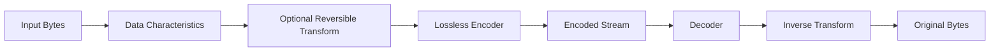

<div align="center">

# HobbitZip
### Lossless compression research, guided by measurable performance


**Compression Research** · **Performance Engineering** · **Reproducible Evaluation**

[English](./README.md) · [Deutsch](./README.de.md) · [Türkçe](./README.tr.md)

</div>

---

## Overview

**HobbitZip** is an experimental engineering project focused on lossless data compression. It examines how data characteristics, reversible transformations, coding strategies and computational constraints affect compression efficiency.

The central objective is not to claim universal superiority over established codecs. It is to evaluate the relationship between **compressed size, encoding speed, decoding speed, memory consumption and correctness** using reproducible measurements.

## Core Engineering Questions

- Which data patterns contain exploitable redundancy?
- When can a reversible preprocessing step improve the final result?
- What is the cost of compression gains in CPU time and memory?
- How do compression and decompression throughput differ?
- How do text, binary data, already-compressed files and small inputs affect results?
- What constraints arise from streaming and bounded-memory processing?

## Conceptual Data Path



The diagram illustrates a possible compression pipeline, **not an assertion that each stage exists in an implementation**. Any transform included in a lossless path must be reversible; decoder compatibility and format boundaries are equally important.

## Correctness Invariant

A lossless round trip must reproduce the input byte for byte:

```text
decompress(compress(input)) == input
```

A valid test suite therefore needs to cover empty inputs, small files, binary content, incompressible data, repeated patterns, truncated streams and malformed input. Compression ratios alone do not establish correctness.

## Benchmark Methodology

| Metric | Definition |
|---|---|
| **Compression ratio** | Uncompressed bytes / compressed bytes |
| **Space saving** | (1 − compressed bytes / original bytes) × 100% |
| **Compression throughput** | Uncompressed input bytes processed per second |
| **Decompression throughput** | Original bytes restored per second |
| **Peak memory** | Maximum memory consumed during a run |
| **Round-trip integrity** | Byte-exact equality after decoding |

Meaningful comparisons require the same datasets, machine, thread configuration and measurement method. The container format and any metadata overhead must be included in compressed-size measurements.

Representative baselines can include established codecs such as **zlib, Zstandard, LZ4 and Brotli**, depending on the workload. Performance results should be reported per dataset rather than as an unsupported universal ranking.

## Research Areas

**Redundancy analysis.** Characterize the input before choosing a coding strategy.

**Reversible transforms.** Evaluate whether preprocessing reduces coding cost enough to justify its runtime and memory overhead.

**Entropy coding.** Explore the relationship between symbol distributions, encoded size and decoder complexity.

**Stream format.** Consider framing, versioning, integrity checks and safe error handling for corrupt or incomplete data.

**Performance and safety.** Measure throughput and memory while protecting the decoder from invalid lengths, malformed streams and excessive resource allocation.

---

<div align="center">

**HobbitZip** · `Lossless Compression` · `Algorithms` · `Benchmarking` · `Systems Engineering`

Created by [Taha Kubilay](https://github.com/tahakubilay)

</div>
