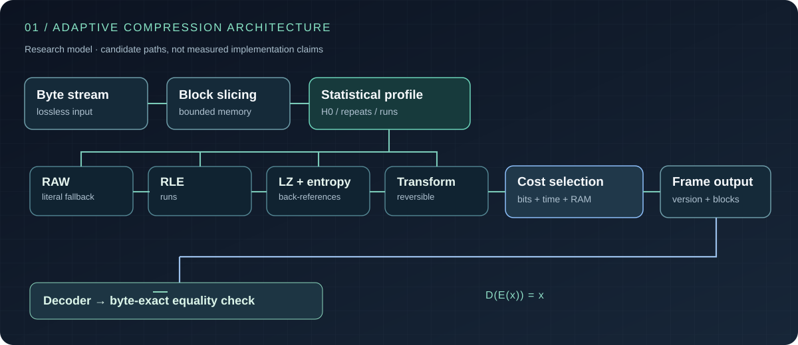
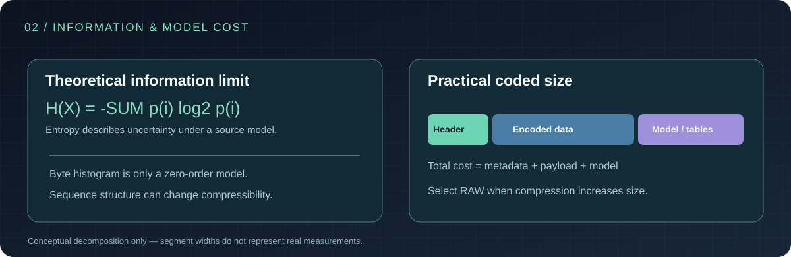
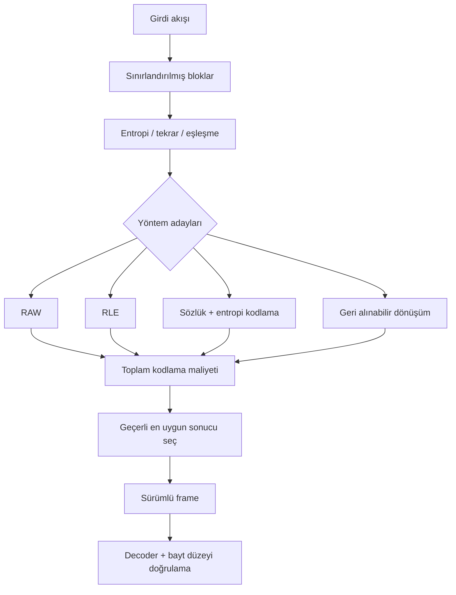

<div align="center">

# HobbitZip
### Uyarlanabilir kayıpsız veri sıkıştırmanın algoritmik ve matematiksel incelemesi


**Bilgi Kuramı** · **Kayıpsız Kodlama** · **Adaptif Blok Seçimi** · **Sistem Performansı**

[English](./README.md) · [Deutsch](./README.de.md) · [**Türkçe**](./README.tr.md)

</div>

---

## Özet

**HobbitZip**, sistem mühendisliğinin temel sorularından birini araştırır: **Kayıpsız bir sıkıştırıcı, veri bölgelerinin istatistiksel özelliklerine uygun kodlama yolunu seçerek daha küçük çıktı üretebilir mi; bunu yaparken açma maliyetini kabul edilebilir düzeyde tutabilir mi?**

Sıkıştırma yalnızca algoritma seçmek değildir. Bilgi içeriği, istatistiksel modelin karmaşıklığı, format ek yükü, CPU süresi, bellek tüketimi, veri boyutu ve çözücü maliyeti arasında bir optimizasyon problemidir.

Araştırmanın merkezinde **geri dönüşümlü dönüşümler**, **sözlük ve run-length kodlama**, **entropi kodlama**, **blok bazında yöntem seçimi** ve **yerleşik codec'lerle tekrarlanabilir karşılaştırmalar** bulunur. Aşağıdaki mimari bir araştırma modelidir; deneysel olarak doğrulanmamış sıkıştırma oranları, hız değerleri veya üstünlük iddiaları içermez.



## 1. Problemin Matematiksel Tanımı

Girdi bayt dizisi \(x \in \{0,\ldots,255\}^{n}\) için kayıpsız kodlayıcı \(E\) ve kod çözücü \(D\) şu koşulu sağlamalıdır:

$$
\boxed{D(E(x)) = x \quad \forall\,x}
$$

Eşitlik **bayt düzeyinde eksiksiz** olmalıdır. Benzer görünen bir belge veya yaklaşık geri oluşturulmuş bir görsel kayıpsız sıkıştırma sonucunu temsil etmez.

Girdi uzunluğu \(n\), sıkıştırılmış toplam boyut \(m\) bayt ise:

$$
R(x) = \frac{n}{m}, \qquad
S(x) = 1 - \frac{m}{n}, \qquad n>0,\ m>0
$$

Burada \(R\) sıkıştırma oranını, \(S\) alan tasarrufunu belirtir. **Header, blok tanımlayıcıları, sözlük, checksum ve metadata dahil bütün baytlar \(m\) içinde sayılır.** Boş girdiler ve sıfır uzunluk durumları ayrı ele alınmalıdır.

### Her veriyi küçülten algoritma neden mümkün değil?

Uzunluğu \(n\) bit olan olası girdi sayısı \(2^n\)'dir. Bundan daha kısa bit dizilerinin toplam sayısı ise:

$$
\sum_{k=0}^{n-1} 2^k = 2^n - 1
$$

Bu nedenle tek anlamlı çözülebilen, bire bir bir eşleme **bütün olası girdileri küçültemez**. Bazı girdiler aynı boyutta kalmak veya büyümek zorundadır. RAW blok seçeneği bu yüzden başarısızlık değil, doğru algoritmik tasarımın parçasıdır.

## 2. Bilgi Kuramı Temeli

Sembol olasılıkları \(p_i\) olan ayrık bir \(X\) kaynağının Shannon entropisi:

$$
H(X)=-\sum_i p_i\log_2 p_i
\quad \text{bit/sembol}
$$

Belleksiz bir kaynak modelinde \(n\) sembollük verinin ideal kodlama maliyeti, model varsayımları altında \(nH(X)\) bit değerine yaklaşır. Ardışık bağımlılıklara sahip verilerde ise **koşullu entropi veya entropi oranı** önemlidir. Yalnızca bayt frekanslarını hesaplamak bu bağımlılıkları yakalayamaz.

Bir \(b\) bloğu için deneysel sıfırıncı derece entropi tahmini:

$$
\widehat H_0(b) =
-\sum_{a\in\Sigma}\frac{f_a}{|b|}
\log_2\left(\frac{f_a}{|b|}\right)
$$

\(f_a\), \(a\) sembolünün sayısını; \(|b|\) blok uzunluğunu belirtir. Sıfır frekanslı terimler dışarıda bırakılır. Bu tahmin algoritma adaylarını değerlendirmede kullanılabilir, ancak **gerçek sıkıştırılmış boyutu garanti etmez**.



İki blok benzer bayt dağılımına sahip olabilir. Bunlardan biri uzun tekrarlar içerirken diğeri farklı sıralamalarla yazılmış olabilir. LZ türü yöntemlerin ikinci dereceden ve daha uzun örüntülere duyarlı olması, sadece histogram yerine yapı analizinin neden gerekli olduğunu gösterir.

## 3. Algoritmik Adaylar

| Yöntem | Temel mekanizma | Güçlü yön | Maliyet / sınır |
|---|---|---|---|
| **RAW** | Veriyi sıkıştırmadan sakla | Zor sıkıştırılan bloklar için güvenli geri dönüş | Header ek yükü |
| **RLE** | Aynı sembolün tekrarlarını kodla | Uzun özdeş tekrarlar | Düzensiz veride büyüme |
| **LZ77** | Önceki dizilere geriye dönük referans | Tekrarlanan diziler ve yapısal örüntüler | Arama süresi ve pencere belleği |
| **Huffman** | Sık sembole kısa prefix kod ata | Dengesiz sembol frekansları | Kod ağacı / tablo maliyeti |
| **rANS / FSE** | Durum tabanlı entropi kodlama | Uygun modelde entropiye yakın oran | Normalizasyon, tablo, karmaşıklık |
| **Dönüşüm + kodlama** | Sıkıştırma öncesi geri alınabilir düzenleme | Yapısal veriler | İşlem ve ters dönüşüm yükü |

Bunlar **araştırılan algoritma aileleridir**; HobbitZip'in tamamını uyguladığı veya bilinen algoritmaları ilk kez icat ettiği iddia edilmez.

### 3.1 Run-Length Encoding (RLE)

Tekrarlanan sembol dizisi kavramsal olarak \((v,\ell)\) ile ifade edilir. \(v\) sembol, \(\ell\) tekrar uzunluğudur.

$$
C_{\mathrm{RLE}}(\ell) =
B(v)+B(\ell)+B_{\mathrm{tag}}
$$

Bir baytın \(\ell\) kez tekrarlandığı durumda RLE ancak \(C_{\mathrm{RLE}}(\ell)<8\ell\) ise avantajlıdır. Gerçek format, literal içerikle tekrar dizisini ayıran işaretleri de taşımalıdır.

### 3.2 LZ77 / sözlük eşleştirme

Geriye dönük bir eşleşme token'ı:

$$
t=(d,\ell),\qquad 1\le d\le W
$$

Burada \(d\) mesafe, \(\ell\) eşleşme uzunluğu, \(W\) geçmişte tutulabilen pencere sınırıdır. Eşleşmeyen baytlar literal olarak saklanır.

Büyük pencere daha uzaktaki tekrarları yakalayabilir; ancak arama ve bellek yükünü artırabilir. Greedy ve lazy parsing, hash tabloları, eşleşme zinciri sınırları ve token formatı elde edilen oranı etkiler. Decoder geçersiz mesafeleri reddetmeli, örtüşen eşleşmeleri doğru açmalı ve bellek sınırlarını aşmamalıdır.

### 3.3 Huffman kodlama

İkili prefix kod uzunlukları \(\ell_i\), Kraft eşitsizliğini sağlar:

$$
\sum_i 2^{-\ell_i} \le 1
$$

Standart varsayımlar altındaki optimal ikili Huffman kodunda ortalama uzunluk \(L\) için:

$$
H(X) \le L < H(X)+1
$$

Gerçek dosyada ağacın veya kanonik kod uzunluklarının tanımlanması, byte hizalama ve format header'ları da alan tüketir. Küçük bloklarda bu metadata, kazancı ortadan kaldırabilir.

### 3.4 rANS: durum tabanlı entropi kodlama

Sembol \(s\), frekans \(f_s\), birikimli frekans \(C_s\) ve toplam \(F=\sum_s f_s\) için soyut bir range-ANS (rANS) dönüşümü:

$$
x'=\left\lfloor\frac{x}{f_s}\right\rfloor F+
C_s+(x\bmod f_s)
$$

Kod çözümünde \(q=x'\bmod F\) değeri, \(C_s\le q<C_s+f_s\) aralığındaki sembolü seçer. Önceki durum:

$$
x=f_s\left\lfloor\frac{x'}{F}\right\rfloor + q - C_s
$$

Bu eşitlikler **normalizasyon hariç temel durum dönüşümünü** gösterir. Gerçek uygulama için byte seviyesinde renormalizasyon, durum sınırları, kodlama sırası, tablo formatı ve deterministik açma kuralları gerekir. ANS bilinen bir algoritma ailesidir; yeni bir HobbitZip buluşu olarak sunulmaz.

## 4. Adaptif Blok Seçimi

Tüm dosyaya aynı yöntemi zorlamak yerine girdi \(b_1,\ldots,b_k\) bloklarına bölünebilir. Her blok için istatistikler çıkarılıp alternatif kodlama yolları karşılaştırılabilir.



\(p\) aday yolunu değerlendirmek için çok hedefli bir araştırma fonksiyonu:

$$
p^*=\arg\min_{p\in\mathcal P_{\mathrm{valid}}}
\left[B_p(b)+\lambda T_p(b)+\mu M_p(b)\right]
$$

Burada \(B_p\) payload **ve metadata bitlerini**, \(T_p\) kodlama süresi/yükünü, \(M_p\) bellek maliyetini; \(\lambda,\mu\) ise uyumlu birimlere göre ağırlıkları belirtir. Bu bir **araştırma hedefi**, gerçek deneylerle ayarlanmış hazır karar algoritması değildir.

Yalnız boyut öncelikliyse \(\lambda=\mu=0\) alınabilir. Düşük gecikmeli kullanımda daha az sıkıştıran hızlı bir yöntem seçmek daha doğru olabilir.

### Minimum Description Length (MDL)

Sıkıştırılmış veri kadar modelin ve formatın açıklama maliyeti de önemlidir:

$$
L_{\mathrm{total}} =
L(\mathrm{model})+
L(\mathrm{data}\mid\mathrm{model})+
L(\mathrm{framing})
$$

Bu yaklaşım, yüksek ayrıntılı istatistiksel modellerin kısa bloklarda neden dezavantajlı olabileceğini açıklar: modele ait tablo ve parametreler, payload tasarrufundan büyük olabilir.

## 5. Akış ve Container Formatı

Kendini tanımlayan olası bir frame tasarımı:

```text
+-----------------------+
| Magic + sürüm         | Dosya türü ve uyumluluk
+-----------------------+
| Frame bayrakları      | Parametreler ve güvenlik sınırları
+-----------------------+
| Orijinal veri boyutu  | Açılmış çıktı sınırı
+-----------------------+
| Blok tanımlayıcıları  | Kodlama türü / sıkışmış ve açık boyut
+-----------------------+
| Blok içerikleri       | RAW / RLE / LZ / entropi kodlu akış
+-----------------------+
| Bütünlük alanı        | Rastlantısal bozulmayı tespit etme
+-----------------------+
```

Bu **kavramsal bir tasarımdır; kesinleşmiş binary spesifikasyon değildir**. Bağımsız blok çözme, bloklar arası sözlük paylaşımı ve rastgele erişim farklı format kararları gerektirir. Checksum yanlışlıkla oluşan bozulmayı gösterebilir ama **kriptografik kimlik doğrulaması değildir**.

## 6. Decoder Güvenliği ve Doğruluk

Kayıpsız sistemin belirleyici bileşeni decoder'dır. Sağlam bir çözümleyici şu kontrolleri zorlamalıdır:

1. Magic, sürüm ve desteklenen bayrakları doğrulama.
2. Uzunluk, offset ve bellek tahsislerinde taşma denetimi.
3. Blok, çıktı, pencere ve bellek üst sınırlarını uygulama.
4. Sözlük referansları ile literal alanlarının sınırlarını kontrol etme.
5. Açılmış veri uzunluğunun tam eşleşmesini isteme.
6. Kesilmiş, bozuk ve desteklenmeyen akışları açık hatayla reddetme.
7. Compression bomb ve aşırı genişleme senaryolarını sınırlama.
8. Property-based test, fuzzing, bilinen test vektörleri ve bağımsız çözücü doğrulaması.

Yalnızca `decode(encode(x)) == x` testi yeterli değildir; encoder ve decoder aynı hatayı paylaşabilir. Bu nedenle bağımsız test vektörleri ve bozuk akış testleri gerekir.

## 7. Deneysel ve Tekrarlanabilir Benchmark Tasarımı

İyi bir sıkıştırıcı iddiası tek dosyadaki başarılı sonuçla değil, tekrarlanabilir ve çeşitli veri kümeleriyle değerlendirilmelidir.

| Veri grubu | Neyi test eder? |
|---|---|
| Doğal dil metni / kaynak kodu | Sembol istatistikleri ve tekrarlar |
| JSON, CSV, log | Sözdizimi ve kayıt yapıları |
| Çalıştırılabilir ikili dosya | Karma veri örüntüleri |
| Ham görüntü / sayısal dizi | Komşuluk ve değer korelasyonu |
| JPEG, PNG, MP4, ZIP | Önceden kodlanmış veya sıkıştırılmış içerik |
| Yüksek entropili rastgele baytlar | RAW fallback ve en kötü durum |
| Çok küçük dosyalar / büyük akışlar | Header maliyeti, throughput |
| Bozuk / kesilmiş akışlar | Güvenlik ve hata yönetimi |

Her veri kümesi ve ayar için **kodlanmış bayt sayısı, oran, sıkıştırma MB/s, açma MB/s, tepe RSS, CPU, platform ve byte-exact integrity** kaydedilmelidir.

### Ölçüm kuralları

- Aynı donanım, CPU ayarı, veri kümesi ve thread sayısı.
- Warm-up ve tekrarlı deney; medyan ve dağılım raporlaması.
- Tek iş parçacığı ve çok iş parçacığı sonuçlarının ayrı tutulması.
- I/O maliyetiyle codec işlem süresinin ayrılması.
- Derleyici, bayraklar, codec sürümü, parametreler ve veri hash'lerinin belirtilmesi.
- **zlib/DEFLATE, Zstandard, LZ4 ve Brotli** ile eşdeğer ayarlarda karşılaştırma.

Önemli grafik türleri: **sıkışmış boyut – encode süresi**, **decode throughput – bellek**, **veri grubu – sıkıştırma oranı**. Bu repodaki SVG'ler kavramsal gösterimdir; **uydurma benchmark grafikleri değildir**.

## 8. Karmaşıklık ve Tasarım Ödünleşmeleri

| Karar | Olası kazanç | Karşılık |
|---|---|---|
| Büyük sözlük penceresi | Daha uzaktaki tekrarların bulunması | Daha fazla RAM ve arama |
| Ayrıntılı eşleşme araması | Daha kısa token dizisi | Daha yüksek sıkıştırma gecikmesi |
| Zengin entropi modeli | Daha isabetli sembol olasılıkları | Model/tablo ek yükü |
| Küçük bloklar | Daha iyi yerel uyarlama | Daha çok header |
| Büyük bloklar | Ek yükün daha iyi amortismanı | Bellek, gecikme, paralellik sınırları |
| Ön dönüşüm | Tekrarların görünür hâle gelmesi | Ek encode/decode işlemi |
| RAW fallback | Gereksiz büyümeyi sınırlama | O blokta sıkıştırma kazancı yok |

Evrensel bir hız/oran üstünlüğü iddia etmek için veri sınıfı, koşullar ve ayarların belirtilmesi gerekir. Tek sayıyla bütün codec'leri sıralamak bilimsel olarak yeterli değildir.

## 9. Araştırma Tezi ve Sınırlar

HobbitZip'in değerlendirdiği fark, **veri karakteristiğine göre geri dönüşümlü kodlama yollarını boyut, gecikme ve bellek kısıtları altında seçebilmek**. Bu yaklaşım yeni bilgi kuramsal sınırlar bulduğunu iddia etmez.

Her deney üç soruyu yanıtlamalıdır:

- **Doğruluk:** Sıkışmış akış byte düzeyinde eksiksiz geri açılıyor mu?
- **Verimlilik:** Model ve başlık dahil toplam dosya gerçekten küçülüyor mu?
- **Pratiklik:** Tasarruf, CPU/RAM ve decoder karmaşıklığını hak ediyor mu?

**HobbitZip'in bu GitHub deposu araştırma yaklaşımı ve mimari sunumudur. Formüller ve diyagramlar tüm yöntemlerin uygulandığını veya belli bir performans seviyesine ulaşıldığını göstermez.**

## Kaynaklar

- C. E. Shannon, *A Mathematical Theory of Communication* (1948).
- [RFC 1951 — DEFLATE](https://www.rfc-editor.org/rfc/rfc1951).
- [RFC 8878 — Zstandard](https://www.rfc-editor.org/rfc/rfc8878).
- [RFC 7932 — Brotli](https://www.rfc-editor.org/rfc/rfc7932).
- J. Duda, *Asymmetric Numeral Systems* (2013), [arXiv:1311.2540](https://arxiv.org/abs/1311.2540).

---

<div align="center">

**HobbitZip** · Bilgi Kuramı × Algoritmalar × Sistem Mühendisliği

Geliştiren: [Taha Kubilay](https://github.com/tahakubilay) · [English](./README.md) · [Deutsch](./README.de.md)

</div>
